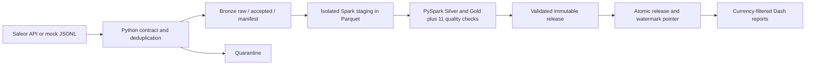

# Saleor Analytics Demo (PySpark)

A Principal Data Engineer interview demo: Saleor GraphQL, a Python Click CLI,
PySpark, Parquet, Airflow and Plotly Dash. All data is synthetic and all project
content is in English.

This branch, `codex/pyspark-analytics`, uses PySpark for analytical
transformations and data quality checks, with Parquet for staging, Silver, and
Gold. It replaces the earlier DuckDB/dbt implementation. Dash reads Gold
through pandas/PyArrow; running the dashboard does not start Spark.

## Start here

- [New PC handoff](HANDOFF.md): fresh setup, repeatable demo, Airflow run, and
  runtime data that Git does not transfer.
- [Runnable modern DE demonstration](docs/MODERN_DE_DEMO.md): replay, updates,
  incremental extraction, quarantine and Airflow.
- [CLI user guide for Git Bash](docs/CLI_USER_GUIDE.md): environment setup, commands, and mock ingestion use cases.
- [CLI user guide for PowerShell](docs/CLI_USER_GUIDE_WINDOWS.md): the same workflow with Windows commands.
- [Container testing guide](docs/TESTING.md): recommended PySpark test setup for any host OS.
- [Assessment A-F coverage](docs/ASSESSMENT_REVIEW.md): current PySpark implementation, requirement mapping, and boundaries.
- [Verification record](docs/VERIFICATION.md): observed Spark test results and pending container/runtime checks.
- [Operations](docs/OPERATIONS.md) and [Saleor setup](SALEOR_SETUP.md).
- [Original design](DEMO_DESIGN.md) and [implementation plan](IMPLEMENTATION_PLAN.md).

## Quick start without Docker

Install Python 3.12, Java 17 or later, and uv, then run from the repository root in either shell.
`uv sync --frozen` is required only for the first setup or after `uv.lock`
changes; it may download packages. If the cached `.venv` already works, skip
that step. Use `uv sync --frozen --offline` to check the cache without network
access; it fails quickly if a dependency is missing.

PowerShell:

```powershell
# First setup only.
uv sync --frozen
$demoSession = [guid]::NewGuid().ToString('N')
$env:ANALYTICS_ROOT = Join-Path (Get-Location) "var/demo-$demoSession"
uv run saleor-analytics mock-data "$env:ANALYTICS_ROOT/base.jsonl" --count 20
uv run saleor-analytics ingest-file "$env:ANALYTICS_ROOT/base.jsonl" --snapshot-id base
uv run saleor-analytics build-warehouse --release-id base
uv run saleor-analytics status
uv run saleor-analytics dashboard
```

Git Bash:

```bash
# First setup only.
uv sync --frozen
export ANALYTICS_ROOT="$(pwd -W)/var/demo-$(date +%Y%m%d-%H%M%S)"
uv run saleor-analytics mock-data "$ANALYTICS_ROOT/base.jsonl" --count 20
uv run saleor-analytics ingest-file "$ANALYTICS_ROOT/base.jsonl" --snapshot-id base
uv run saleor-analytics build-warehouse --release-id base
uv run saleor-analytics status
uv run saleor-analytics dashboard
```

Open http://localhost:8050. Expected: 20 orders, USD400 gross order value.
Stop on an unexpected nonzero exit code. The mock generator creates local
Saleor-shaped JSONL; it does not modify Saleor. For a real API source and Airflow,
follow the linked guides. Clone with `--recurse-submodules` for the pinned
upstream Saleor development stack.

## Architecture and guarantees



`build-warehouse` keeps its existing CLI name, but the warehouse is now a
versioned directory of analytical Parquet datasets. There is no `.duckdb`
database file or dbt model/test execution in this branch. Python ingestion
normalizes the accepted contract; `spark_engine.py` performs the cross-snapshot
DataFrame transformations and 11 dataset checks.

Same-input retries reuse snapshots; exact duplicates collapse; conflicting
versions fail. Invalid rows are quarantined, with a configurable reject threshold.
Current-state models select the complete latest order and line set. Both build
and direct publication require checksum-bound Spark evidence. Failed validation
or publication preserves the previously served release and source checkpoint.

Incremental API polling uses `updatedAt`, persisted bounds and five-minute
overlap. This is not log CDC: hard deletes and every intermediate mutation are
not captured. Spark rebuilds from accepted history at this scale. Staging,
Silver, and Gold are Parquet datasets in each immutable release.
An existing DuckDB release pointer can be superseded by building a new Spark
release from retained Bronze snapshots that pass the current v2 contract and
checksum checks; use a new release ID. For older contracts, use a fresh root
and re-ingest the retained raw input under new IDs. The new dashboard does not
serve the legacy database release.

### Parquet datasets

Each validated release stores its analytical datasets under
`releases/<release-id>/dataset/`. PySpark writes them; Dash reads the small
Gold outputs with PyArrow.

| Layer | Parquet path in `dataset/` | Grain / purpose |
|---|---|---|
| Staging | `staging/order_versions/` | Approved order versions from Bronze. |
| Silver | `silver/orders/` | One current, trusted version per Saleor order. |
| Silver | `silver/order_lines/` | One current line per current order version. |
| Gold | `gold/daily_order_metrics/` | Daily order count, gross value, and average order value by channel and currency. |
| Gold | `gold/daily_product_metrics/` | Daily units and gross value by product, channel, and currency. |

Bronze evidence is file-based: raw and accepted
JSONL plus a manifest are stored under `bronze/<snapshot-id>/`.

For a quick inspection, read a Gold directory with
`pandas.read_parquet("<analytics-root>/releases/<release-id>/dataset/gold/daily_order_metrics")`.

Airflow orders preparation, ingestion, Spark staging, transformation/checks, publication and monitoring.
Mock generation is optional and restricted to manual runs. Dash reloads one
release every 30 seconds, with matching currency/channel/date filters for KPIs
and charts. Gross order value excludes draft/canceled orders; it is not recognized
revenue. No conversion or cross-currency total is implied.

## Repository structure

```text
src/saleor_analytics/
  cli.py                Click commands and workflow boundaries
  api.py, extract.py    Saleor GraphQL requests and bounded extraction
  records.py            Python contract validation and normalization
  pipeline.py           Bronze, candidate lifecycle, hashes, and publication
  spark_engine.py       PySpark staging, Silver/Gold transforms, and 11 checks
  dashboard.py          Dash reports reading Gold Parquet through pandas/PyArrow
dags/                   Airflow daily orchestration
tests/                  Python and real Spark failure/recovery tests
samples/                Small synthetic JSONL fixtures
config/                 Non-secret runtime configuration examples
infra/airflow/          Runtime/test image targets, Compose, and dependency locks
infra/saleor-platform/  Pinned upstream source application submodule
.github/workflows/      Ubuntu CI validation and illustrative promotion
scripts/                Git Bash presentation launcher
docs/                   CLI, testing, operations, assessment, and verification
var/, artifacts/        Ignored local outputs; Airflow runtime data uses a named volume
```

The former dbt `analytics/` models are retired. Staging and Silver/Gold logic
live in the Python package and are installed with it.

## Validation and delivery

Run tests **inside the Linux container**, from the repository root in either
PowerShell or Git Bash. Docker Desktop must use Linux containers. No host
Python, Java, uv, or Windows Hadoop helpers are needed for this workflow:

```bash
docker compose -f infra/airflow/compose.test.yml build tests
docker compose -f infra/airflow/compose.test.yml run --rm --no-deps tests
docker compose -f infra/airflow/compose.test.yml run --rm --no-deps tests ruff format --check src tests dags
docker compose -f infra/airflow/compose.test.yml run --rm --no-deps tests ruff check src tests dags
```

Build before running; rebuild after source, test, or dependency changes. The
disposable runner includes real Spark builds and publication-failure recovery,
without mounting demo data. See [testing instructions](docs/TESTING.md) for
expected results, focused runs, and isolation details. The native quick start
above is an optional demo route, not a prerequisite for container tests.

GitHub Actions validates pull requests and main directly on a Linux runner,
including package builds; it does not currently build this test image. GitLab
CI is an alternative example. The manual
production environment job is a promotion illustration, not a deployed service;
configure repository protection/reviewers separately. Runtime data, local secrets,
and AI configuration/prompt logs are ignored by Git.

The demo uses local filesystem locks, a single-node Spark session and environment
secrets. HA, cloud IAM, external alert delivery, retention enforcement, source
completeness guarantees and a 4 GB full-stack acceptance test remain outside
implemented scope. Use a fresh data root for contract v2; legacy snapshots are
not silently upgraded.
